# SAÉ S1.05-06 – Dassault Systèmes

Bienvenue sur le dépôt de notre site web consacré à **Dassault Systèmes**, réalisé en groupe dans le cadre de la SAÉ 1.05-06 en première année de BUT Informatique, à l'IUT Nord Franche-Comté (Belfort), groupe S1A1.

## Où voir le site ?

Le site est en ligne sur trois plateformes. Nous sommes cinq dans le groupe, et il fallait donc le publier ailleurs que sur GitHub uniquement :

- [GitHub Pages](https://enesim21.github.io/DASSAULT-SYSTEME/) (version principale)
- [GitLab Pages](https://dassault-systeme-79006b.gitlab.io/)
- [Bitbucket Pages](https://dassaultsysteme.bitbucket.io/)

Les trois versions présentent le même contenu. Le code source se trouve dans le [dépôt GitHub du projet](https://github.com/enesim21/DASSAULT-SYSTEME).

## Qui sommes-nous ?

Nous sommes cinq étudiants du groupe S1A1. N'hésitez pas à nous écrire :

- [Sami BEN SLIMA (référent)](mailto:sami.ben-slima@edu.univ-fcomte.fr?subject=SAE_1_05_06)  
- [Enes AVSAR](mailto:enes.avsar@edu.univ-fcomte.fr?subject=SAE_1_05_06)  
- [Jonathan BUHL](mailto:jonathan.buhl@edu.univ-fcomte.fr?subject=SAE_1_05_06)  
- [Marius BAUDON--RIGAL](mailto:marius.baudon--rigal@edu.univ-fcomte.fr?subject=SAE_1_05_06)  
- [Moubaraka AHAMAD](mailto:moubaraka.ahamad@edu.univ-fcomte.fr?subject=SAE_1_05_06)  

## De quoi parle le site ?

Dassault Systèmes est une entreprise française spécialisée dans les logiciels de conception 3D et les « jumeaux virtuels ». Notre site raconte son histoire, présente ses domaines d'activité et ses principaux produits, puis s'intéresse à son économie et à son empreinte écologique. Chacun de nous a construit au moins une page et signe son travail dans le pied de page.

Le site est disponible en français et en anglais : un petit bouton dans la barre de navigation permet de changer de langue.

## Comment le dépôt est organisé

```
DASSAULT-SYSTEME
├── index.html
├── histoire.html
├── domaines.html
├── produits.html
├── economie.html
├── ecologie.html
├── README.md
├── css
│   ├── commun.css      (barre de navigation, pied de page, bouton de langue)
│   ├── accueil.css
│   ├── histoire.css
│   ├── domaines.css
│   ├── produits.css
│   ├── economie.css
│   └── ecologie.css
├── js
│   └── traduction.js   (traduction français / anglais)
├── images
│   ├── logo.png
│   ├── favicon.ico
│   ├── accueil
│   ├── histoire
│   ├── Produit
│   └── economie
└── doc                 (captures W3C, EcoIndex et contributeurs)
```

## Nos choix de conception

- **Une charte graphique commune.** Sami a préparé un « style tile » pour le groupe. Toutes les pages partagent la même palette (#293947, #0B5D75, #429DAD, #BAE9EA, #E9F6FD), la police Space Grotesk et le même fond clair, #E9F6FD.
- **Un menu et un pied de page identiques partout.** Ils sont regroupés dans `css/commun.css`. Le lien de la page en cours apparaît en gras dans le menu, et chaque pied de page indique qui a réalisé la page.
- **Des bannières et des titres de même taille** sur les pages de contenu, en reprenant le modèle de la page Produits.
- **Une version anglaise.** Le script `js/traduction.js` remplace les textes de la page à partir d'un dictionnaire, et retient la langue choisie quand on passe d'une page à l'autre.
- **Des graphiques faits maison.** Ceux de la page Économie ont été réalisés avec Excel à partir des chiffres publiés par Dassault Systèmes, puis exportés en images.
- **Un site léger.** Nous avons redimensionné et compressé les images pour que chaque page obtienne la note A sur EcoIndex.

## Les tests : W3C et EcoIndex

Nous avons vérifié chaque page avec le [validateur W3C](https://validator.w3.org/nu/) et avec [EcoIndex](https://www.ecoindex.fr/). Ces tests ont été faits par **Enes AVSAR**. Voici les résultats page par page.

### Page d'accueil

Réalisée par **Sami BEN SLIMA**. Le validateur W3C ne signale aucune erreur sur cette page ([voir le détail](https://validator.w3.org/nu/?showsource=yes&showoutline=yes&showimagereport=yes&doc=https%3A%2F%2Fenesim21.github.io%2FDASSAULT-SYSTEME%2Findex.html)), et EcoIndex lui donne la note A.

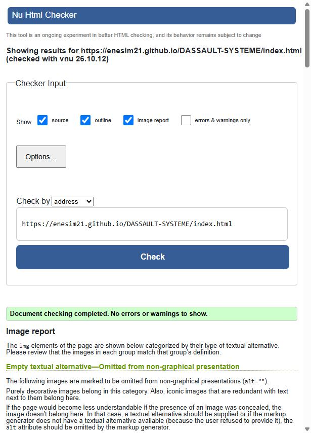

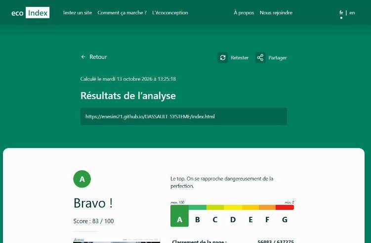

### Histoire

Réalisée par **Moubaraka AHAMAD**. Le validateur W3C ne signale aucune erreur sur cette page ([voir le détail](https://validator.w3.org/nu/?showsource=yes&showoutline=yes&showimagereport=yes&doc=https%3A%2F%2Fenesim21.github.io%2FDASSAULT-SYSTEME%2Fhistoire.html)), et EcoIndex lui donne la note A.


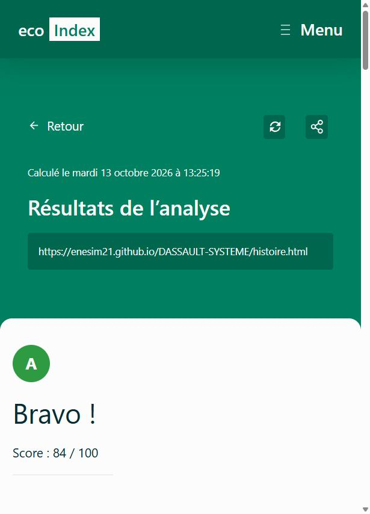

### Domaines

Réalisée par **Jonathan BUHL**. Le validateur W3C ne signale aucune erreur sur cette page ([voir le détail](https://validator.w3.org/nu/?showsource=yes&showoutline=yes&showimagereport=yes&doc=https%3A%2F%2Fenesim21.github.io%2FDASSAULT-SYSTEME%2Fdomaines.html)), et EcoIndex lui donne la note A.

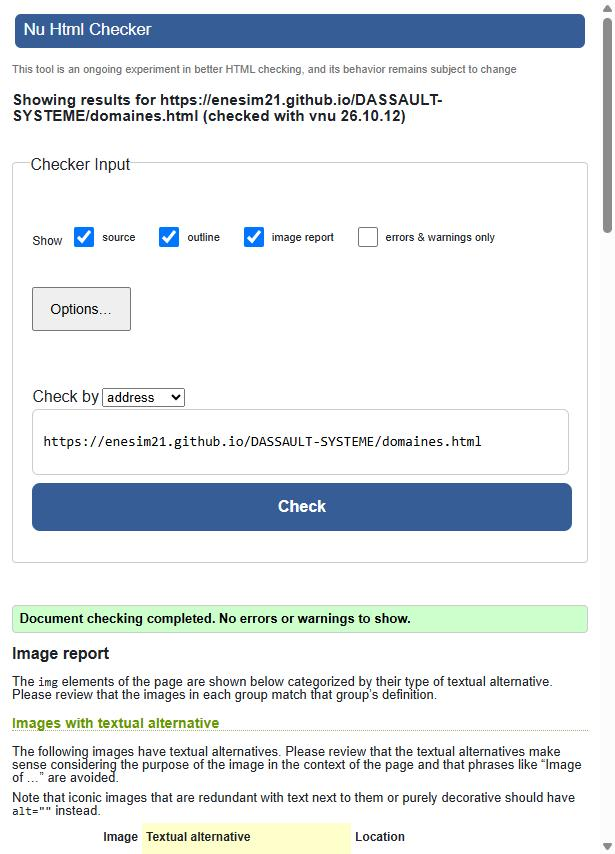

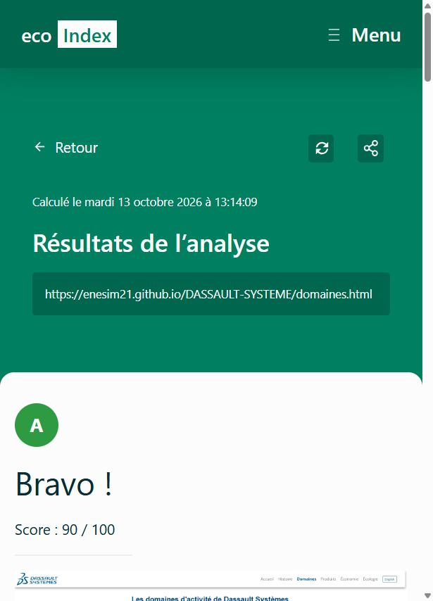

### Produits

Réalisée par **Marius BAUDON--RIGAL**. Le validateur W3C ne signale aucune erreur sur cette page ([voir le détail](https://validator.w3.org/nu/?showsource=yes&showoutline=yes&showimagereport=yes&doc=https%3A%2F%2Fenesim21.github.io%2FDASSAULT-SYSTEME%2Fproduits.html)), et EcoIndex lui donne la note A.

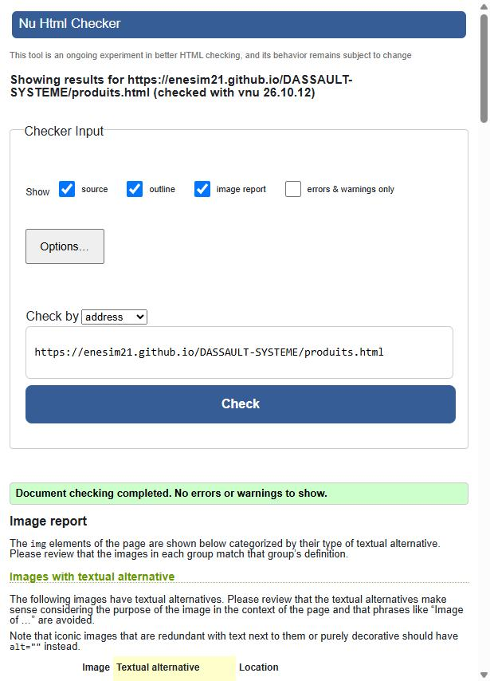


### Économie

Réalisée par **Enes AVSAR**. Le validateur W3C ne signale aucune erreur sur cette page ([voir le détail](https://validator.w3.org/nu/?showsource=yes&showoutline=yes&showimagereport=yes&doc=https%3A%2F%2Fenesim21.github.io%2FDASSAULT-SYSTEME%2Feconomie.html)), et EcoIndex lui donne la note A.

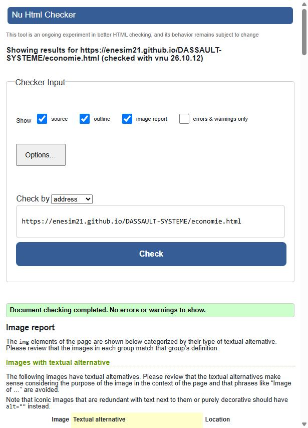

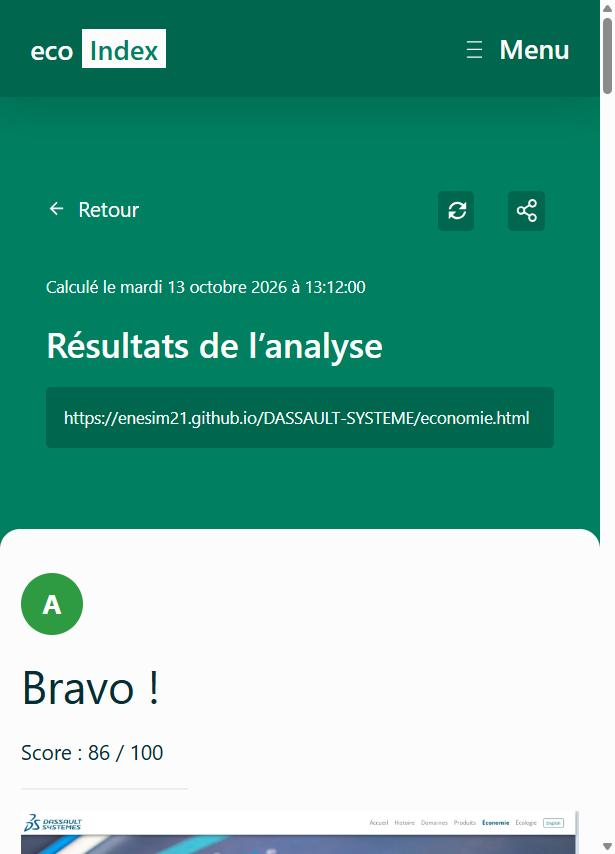

### Écologie

Réalisée par **Jonathan BUHL**. Le validateur W3C ne signale aucune erreur sur cette page ([voir le détail](https://validator.w3.org/nu/?showsource=yes&showoutline=yes&showimagereport=yes&doc=https%3A%2F%2Fenesim21.github.io%2FDASSAULT-SYSTEME%2Fecologie.html)), et EcoIndex lui donne la note A.

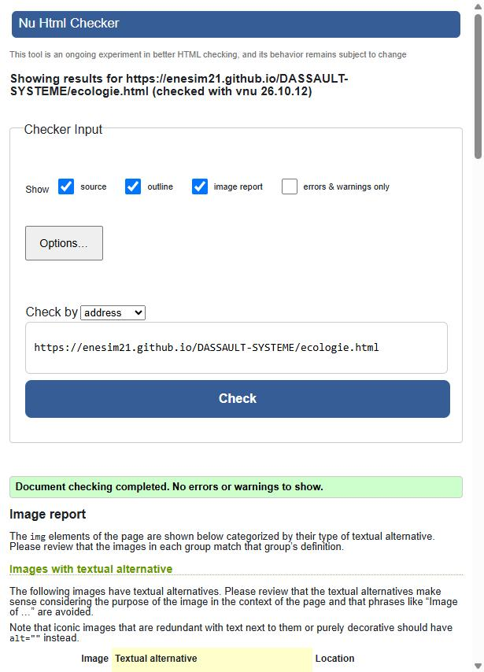

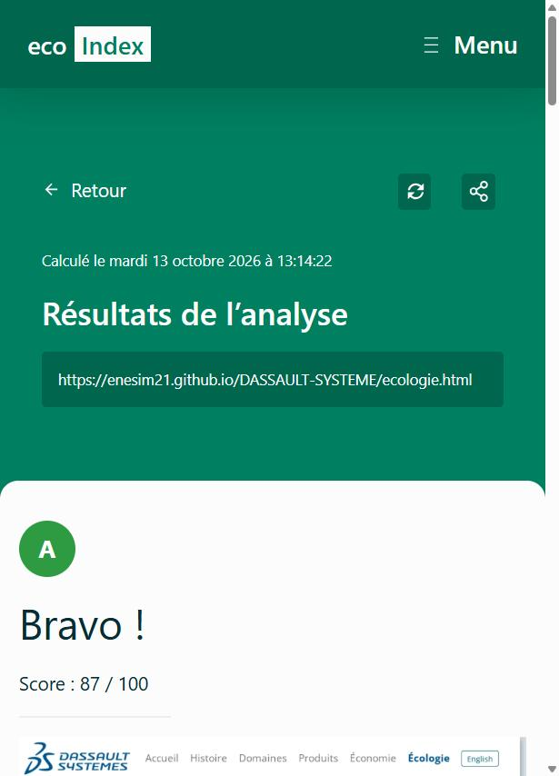

## Qui a fait quoi ?

### Coordination du groupe

- Sami BEN SLIMA (référent) : organisation du groupe, « style tile » et charte graphique

### Les pages du site

- Sami BEN SLIMA
  - Page d'accueil
- Moubaraka AHAMAD
  - Page Histoire
- Jonathan BUHL
  - Page Domaines
  - Page Écologie
- Marius BAUDON--RIGAL
  - Page Produits
- Enes AVSAR
  - Page Économie et ses graphiques (Excel)
  - Barre de navigation et pied de page communs (`css/commun.css`)
  - Traduction français / anglais (`js/traduction.js`)
  - Tests W3C et EcoIndex, compression des images, README

## Les contributeurs

Pour s'y retrouver dans l'historique du dépôt, voici le lien entre les comptes GitHub et les membres du groupe :

| Compte GitHub | Membre |
|---|---|
| sami9z | Sami BEN SLIMA |
| enesim21 | Enes AVSAR |
| magolorh2-spec | Jonathan BUHL |
| mariusbrigal33-hub | Marius BAUDON--RIGAL |
| moubarakaahamad-png | Moubaraka AHAMAD |

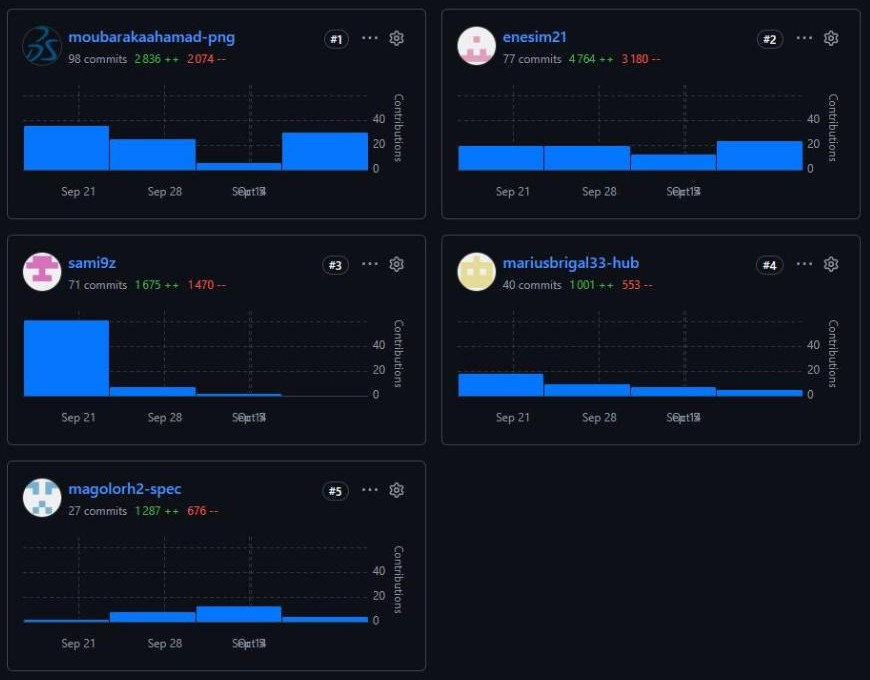
